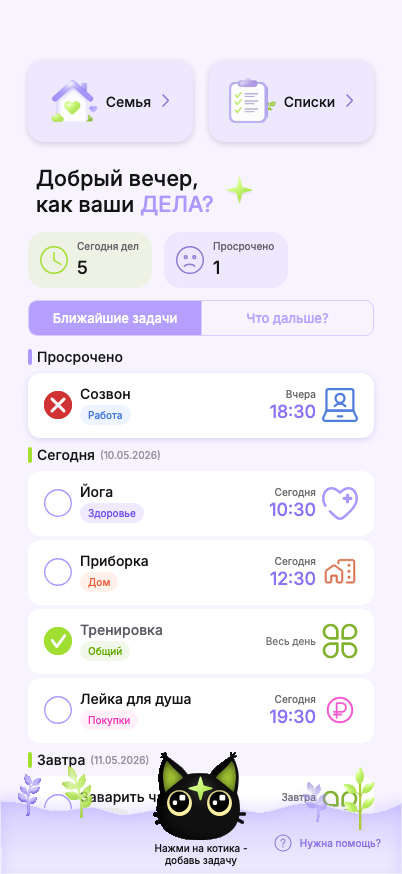
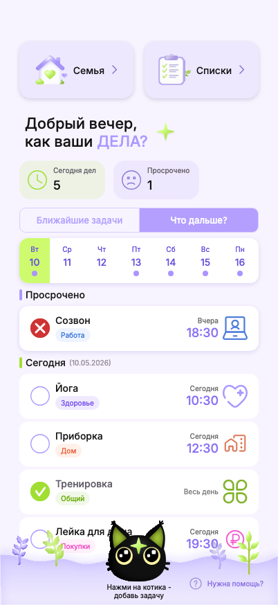
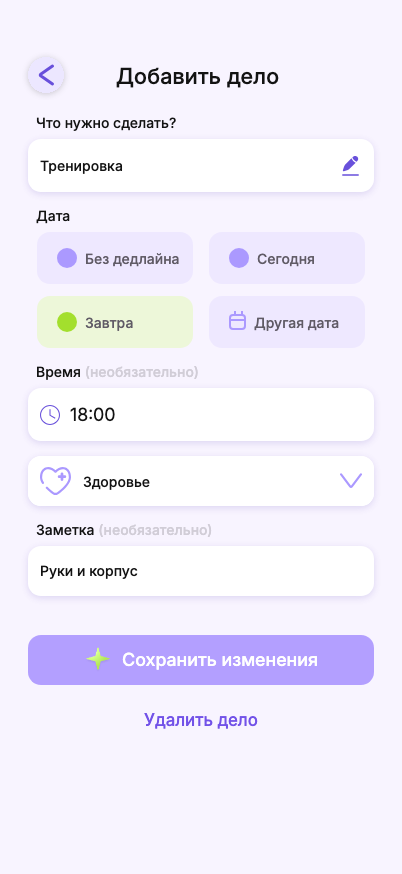

# Котик — семейный список дел в Telegram

Добавьте дело, назначьте срок и следите за общим списком вместе с семьёй. В чате «Котик» напомнит о задаче, а в мини-приложении покажет, что запланировано на сегодня и ближайшие дни.

**[Открыть «Котика» в Telegram](https://t.me/easy_task_manager_bot)**

  
  
  

  <a href="docs/images/tasks.png">Ближайшие дела</a> ·
  <a href="docs/images/calendar.png">Календарь</a> ·
  <a href="docs/images/edit.png">Редактирование дела</a>

## Попробовать вместе

1. **Соберите семью.** Отправьте боту `/start`, нажмите **Создать семью** и откройте **Семья → Пригласить**. Перешлите близкому человеку одноразовый код или ссылку.
2. **Добавьте общее дело.** Откройте мини-приложение кнопкой **Котик** и нажмите на кота внизу экрана. Введите, например, «Записать кота к ветеринару» и выберите дату и время.
3. **Включите напоминание.** Пока создаёте дело, включите **Напомнить** и сохраните задачу. Она появится в общем списке. Для регулярных дел в карточке бота можно выбрать ежедневный, еженедельный или ежемесячный повтор.

## Запустить своего бота

Бот написан на Python с aiogram, мини-приложение — на React и TypeScript. Задачи, списки, участники и состояние напоминаний хранятся в локальных JSON-файлах. [Установка, настройка и тесты](docs/usage.md)

## Права на материалы

Авторский код Павла Марчика распространяется по [PolyForm Noncommercial 1.0.0](LICENSE). Для коммерческого использования авторского кода требуется отдельное разрешение.

Все права на [иллюстрации и иконки «Котика»](web/src/assets/figma/), в том числе показанные на скриншотах, сохранены за их автором. Павел Марчик использует их с разрешения автора. Графика исключена из лицензии на код. Для её использования в других проектах, включая бесплатные, требуется отдельное разрешение автора.

Шрифт Inter распространяется по [SIL Open Font License 1.1](web/src/assets/fonts/Inter-OFL.txt). Сторонние библиотеки сохраняют лицензии своих правообладателей.
